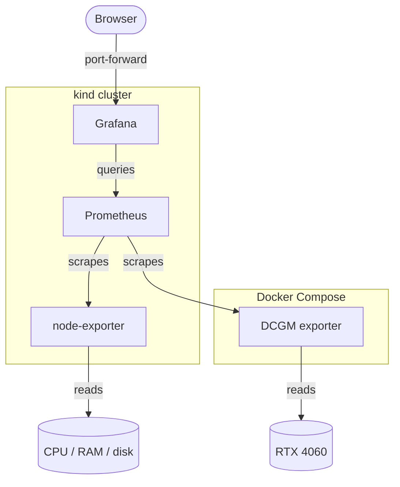

# gpu-monitoring-lab

On GPU servers you need to see utilization, temperature and power to catch idle, overloaded or overheating GPUs. This is a GPU monitoring stack I built and debugged step by step on my own laptop: GPU in Docker, metrics with NVIDIA DCGM and Prometheus, dashboards in Grafana provisioned from git, first on Docker Compose, then moved to Kubernetes (kind).

**Tech:** Linux · Docker / Docker Compose · NVIDIA Container Toolkit · DCGM · Prometheus · Grafana · Kubernetes (kind) · WSL2


## What I built
- **GPU in containers:** Docker + NVIDIA Container Toolkit on WSL2, verified with `nvidia-smi` inside a CUDA container. [→ docs](docs/gpu-in-containers.md)
- **Monitoring stack, first version** (Docker Compose): DCGM exporter (GPU) and node_exporter (CPU, RAM, disk) → Prometheus → Grafana. [→ docs](docs/monitoring.md)
- **Dashboard as code:** the Grafana datasource and dashboard are files in git, loaded at startup. Recreating the container brings everything back with no manual clicks. [→ docs](docs/monitoring.md#dashboard-as-code)
- **Kubernetes (kind):** the same stack as manifests in git. [→ docs](docs/kubernetes.md) · [architecture](docs/architecture.md)
  - **Prometheus:** Deployment + Service (fixed address; self-healing tested by deleting the Pod), config mounted from a ConfigMap.
  - **node_exporter:** DaemonSet, so every node runs one.
  - **Grafana:** datasource, provider and dashboard from ConfigMaps (same `gpu.json` as in Compose).
  - **DCGM exporter:** stays in Docker, because kind can't pass the GPU into its node container. Compose joins the cluster's Docker network, so Prometheus scrapes it by name.


Prometheus scrapes every 15 s and stores time series; Grafana's datasource and dashboard come from git. Addresses, ports and networks: [architecture](docs/architecture.md).

## Run it
Needs: an NVIDIA GPU + driver, Docker, and the [NVIDIA Container Toolkit](https://docs.nvidia.com/datacenter/cloud-native/container-toolkit/latest/install-guide.html). Tested on Ubuntu in WSL2.

```bash
kind create cluster --name gpu-lab                        # creates the "kind" Docker network that Compose joins
(cd monitoring && docker compose up -d dcgm-exporter)     # only the GPU exporter stays in Docker
kubectl apply -f k8s/                                     # Prometheus, node_exporter, Grafana + ConfigMaps
kubectl port-forward svc/grafana 3000:3000
```
The DCGM exporter joins the `kind` network so Prometheus on Kubernetes can scrape it ([details](docs/kubernetes.md#dcgm-exporter-in-docker-reachable-from-the-cluster)).
Grafana: http://localhost:3000 (default login `admin` / `admin`, change it on first login) → folder **GPU**. Prometheus: `kubectl port-forward svc/prometheus 9090:9090` → http://localhost:9090.

## Troubleshooting highlights
Real problems I hit, written up as incident reports (symptom → diagnosis → root cause → fix → lesson) in [docs/troubleshooting.md](docs/troubleshooting.md):
- **GPU not visible in Docker:** two Docker engines were installed, and the sandboxed snap one couldn't reach the driver.
- **No DNS in WSL:** ping by IP worked, names didn't, so the problem was DNS (a WSL setting). The second time, the cause was an active VPN.
- **Impossible metrics:** 590 W idle on a 45 W GPU. Check physical limits before trusting a dashboard.
- **Provisioned dashboard showed "datasource not found":** an import placeholder that only the UI fills in, fixed with a fixed datasource uid.
- **kind cluster gone:** a Docker daemon restart stopped the node container, and its restart policy doesn't cover that. `sudo kubectl` was a red herring (root has no kubeconfig).
- **Empty GPU dashboard after a laptop restart:** the Pods came back by themselves, the DCGM container in Compose didn't (no restart policy). Fixed with `restart: unless-stopped`.

## In production I'd…
- **Keep the metrics:** store Prometheus data on a PersistentVolume. Here it lives inside the container: after a laptop restart, the graph started 5 hours ago, not 5 days.
- **Alert, not only watch:** Alertmanager rules for a target that goes down or a GPU that runs hot. Here the DCGM exporter stayed stopped after a restart and only an empty dashboard showed it.
- **Run the GPU exporter in the cluster:** the NVIDIA GPU Operator installs the device plugin and the DCGM exporter on every GPU node (kind can't pass the GPU through).
- **Keep secrets out of git:** the Grafana admin password from a Kubernetes Secret, not the default login.
- **Install with Helm** (kube-prometheus-stack) instead of hand-written manifests. I wrote them by hand here to learn each piece.

## Repo layout
```
monitoring/   Docker Compose stack, Prometheus config, Grafana provisioning + dashboard
k8s/          Kubernetes manifests
hardware/     raw outputs (lscpu, nvidia-smi, GPU-in-Docker test)
docs/         details per topic + troubleshooting
```

## Roadmap
- [x] GPU in Docker (NVIDIA Container Toolkit)
- [x] Monitoring with Prometheus + node_exporter + DCGM exporter → Grafana
- [x] Grafana dashboard as code (provisioned from git)
- [x] kind cluster, Prometheus Deployment as a manifest, self-healing test
- [x] Pinned image versions (compose + k8s), checked against the running containers
- [x] Service for Prometheus (fixed address, tested by replacing the Pod)
- [x] Prometheus config as a ConfigMap (mounted, verified on the Targets page)
- [x] node_exporter as a DaemonSet + Service on kind (target UP)
- [x] DCGM exporter reachable from the cluster (Compose joins the `kind` network, target UP)
- [x] Grafana on kind (datasource, provider and dashboard as ConfigMaps)
- [x] Restart policy for the DCGM exporter (comes back after a Docker restart)
- [x] README final (architecture diagram, "In production I'd…")
