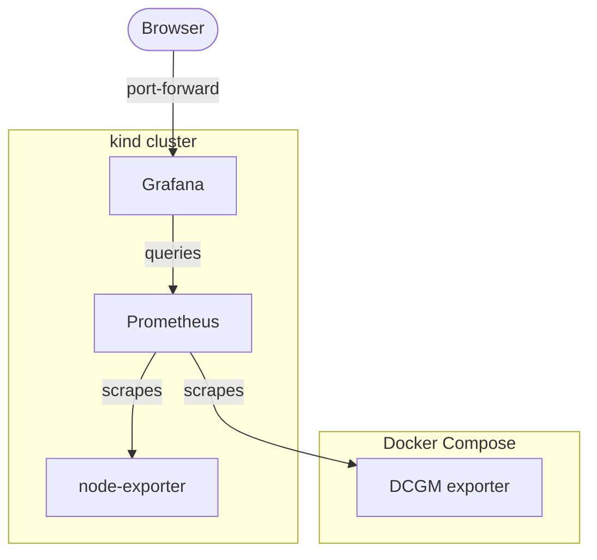

# Architecture

Snapshot of 27.10.2026 (IPs from `k9s`, `kubectl get svc` and `docker network inspect kind`). Laptop: Windows 11 → WSL Ubuntu → Docker network `kind` (172.22.0.0/16).

| Component | Runs as | Address (Service / container) | Config from |
|---|---|---|---|
| Grafana | Deployment + Service | `grafana` · 10.96.26.253:3000 | 3 ConfigMaps (datasource, provider, dashboard) |
| Prometheus | Deployment + Service | `prometheus` · 10.96.139.120:9090 | ConfigMap → `/etc/prometheus` |
| node-exporter | DaemonSet + Service | `node-exporter` · 10.96.88.156:9100 | – |
| DCGM exporter | Compose container (has the GPU) | `dcgm-exporter` · 172.22.0.3:9400 | – |
| CoreDNS | kube-system | `kube-dns` · 10.96.0.10:53 | – |

kind node `gpu-lab-control-plane` = 172.22.0.2.

Three networks: **10.244.x.x** = Pods (IP changes on restart) · **10.96.x.x** = Services (stable IP + DNS name) · **172.22.x.x** = Docker's `kind` network.

| Scrape job | Target | Found via |
|---|---|---|
| `node` | `node-exporter:9100` | Kubernetes Service (CoreDNS answers) |
| `gpu` | `dcgm-exporter:9400` | Docker network alias on `kind` (CoreDNS forwards) |

DCGM stays in Compose because kind can't pass the GPU into the node container. In production I'd run it in the cluster as a DaemonSet via the NVIDIA GPU Operator.
