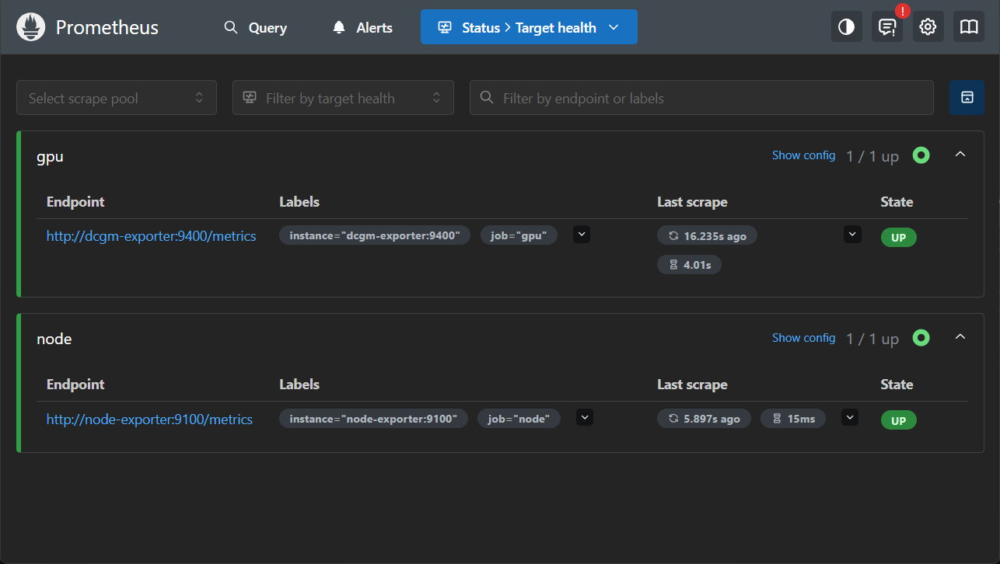

# Kubernetes (in progress)

**Goal:** move the monitoring stack from Docker Compose to Kubernetes. Done so far: a local cluster, Prometheus as a Deployment, a Service in front of it, its config from a ConfigMap, node_exporter as a DaemonSet, and the DCGM exporter (still in Docker) reachable from the cluster: both targets UP. Next: Grafana.

## Cluster: kind
- `kind create cluster --name gpu-lab` → one node, `gpu-lab-control-plane`.
- kind = **K**ubernetes **in** **D**ocker: each node is a container (visible in `docker ps`). kubectl talks to the API server on the node's port 6443.
- Why kind: built for creating and deleting test clusters on a laptop. k3s would be the choice for real small servers; kubectl and the manifests are the same.

```
Laptop → WSL → Docker → [kind node container] → Kubernetes → Pod (Prometheus)
```

## Prometheus as a manifest
- Generated with `kubectl create deployment … --dry-run=client -o yaml`, then cleaned up: [k8s/prometheus-deployment.yaml](../k8s/prometheus-deployment.yaml).
- The Deployment holds the desired state (`replicas: 1`). Its Pod template puts the label `app: prometheus` on every Pod; the selector counts Pods by that label.
- `kubectl apply -f` makes the cluster match the file and is **idempotent**: same file → `unchanged`; `replicas: 1 → 2` → `configured` and a second Pod. Same idea as dashboard as code: the desired state lives in git.

## Self-healing test
Deleted the running Pod → a new Pod with a new name was running 5 s later. The controller saw "1 wanted, 0 running" and created a replacement.

## Service: a fixed address
**Problem:** a Pod's IP changes whenever the Pod is replaced, and even when it restarts (after a Docker restart: same Pod, `10.244.0.6 → 10.244.0.4`). Anything that talks to Prometheus by Pod IP would break.

- Generated with `kubectl expose deployment prometheus --port=9090 --dry-run=client -o yaml`, then cleaned up: [k8s/prometheus-service.yaml](../k8s/prometheus-service.yaml).
- The Service gets a fixed cluster IP and the DNS name `prometheus`. Its selector `app: prometheus` finds the Pods by label, the same way the Deployment does, and its endpoint list follows them.
- `port` = where the Service listens, `targetPort` = the port inside the Pod (both 9090).

**Test:** deleted the Pod and compared before/after.

| | Before | After |
|---|---|---|
| Pod IP | 10.244.0.4 | 10.244.0.6 |
| Service cluster IP | 10.96.139.120 | 10.96.139.120 |
| Endpoints (`kubectl get endpointslices`) | 10.244.0.4:9090 | 10.244.0.6:9090 |

Two controllers, two jobs: the Deployment replaces the Pod, the Service updates where traffic goes. Grafana will connect to `prometheus:9090` and never see the change.

## Config as a ConfigMap
**Problem:** the image ships a default `prometheus.yml`. In Compose I mounted my own file from the laptop; in a cluster a Pod can run on any node, so there is no laptop folder to rely on.

- The config file goes into the cluster as a **ConfigMap** (a Kubernetes object that stores configuration apart from the image): generated with `kubectl create configmap prometheus-config --from-file=… --dry-run=client -o yaml`, saved as [k8s/prometheus-configmap.yaml](../k8s/prometheus-configmap.yaml).
- The Deployment mounts it in two parts: `volumes` (Pod level: **what** is available, filled from the ConfigMap) and `volumeMounts` (container level: **where** it appears, `/etc/prometheus`). The volume name links the two.

```
ConfigMap prometheus-config ──► volume "config" (Pod) ──► /etc/prometheus/prometheus.yml (container)
```

- `kubectl apply` → a **new Pod** (rollout): a running Pod can't change shape, so the Deployment replaced it with one that matches the new template.
- **Check:** `kubectl port-forward svc/prometheus 9090:9090` → `localhost:9090/targets` lists my jobs `node` and `gpu`, so Prometheus reads the ConfigMap.
- **Result: both targets DOWN**, as expected at this stage: `lookup dcgm-exporter on 10.96.0.10:53: no such host`. Port 53 = DNS, `10.96.0.10` = the cluster DNS (CoreDNS). The DNS works, but it only knows the cluster's Services; the names `dcgm-exporter` and `node-exporter` came from the Compose network. **Next:** make the exporters reachable from the cluster.

## node_exporter as a DaemonSet
**Problem:** node_exporter measures the machine it runs on (CPU, RAM, disk), so every node needs its own copy. A Deployment runs N copies on any node; a **DaemonSet** runs **one copy on every node**, and a new node gets one automatically.

- [k8s/node-exporter-daemonset.yaml](../k8s/node-exporter-daemonset.yaml): the same settings as in Compose. `hostPID: true` (= `pid: host`), the node's root folder mounted read-only at `/host` via `hostPath` (= `/:/host:ro`), `--path.rootfs=/host`. Image pinned to the Compose tag `v1.12.1`.
- [k8s/node-exporter-service.yaml](../k8s/node-exporter-service.yaml): a Service named `node-exporter`, port 9100. The ConfigMap already scrapes `node-exporter:9100`, so the config needed no change: the Service makes that name exist in the cluster.
- The first `kubectl apply` failed with `strict decoding error: unknown field "spec.template.spec.containers[0].images"`: the path in the error points to the exact line (a typo, `images` instead of `image`).
- **Result:** Targets page → `node` **UP**, `gpu` still DOWN.
- **Lab limitation:** kind has one node, so one node_exporter Pod. That node is a Docker container, so the disk numbers are that container's filesystem; CPU and RAM come from the shared WSL kernel.
- **In production** I'd install the kube-prometheus-stack Helm chart, which ships node_exporter as a DaemonSet. Writing the manifests by hand here is for understanding each piece.

## DCGM exporter: in Docker, reachable from the cluster
**Problem:** the DCGM exporter needs the GPU, but a kind node is a container inside Docker, so passing the GPU through to a Pod is extra work. So DCGM stays in Docker Compose, and Prometheus in the cluster has to reach `dcgm-exporter:9400` by name. It couldn't: the container was only on the Compose network (`monitoring_default`), the kind node on the `kind` network.

- **Fix:** DCGM joins the `kind` Docker network (kind creates it with the first cluster). First tested by hand with `docker network connect --alias dcgm-exporter kind monitoring-dcgm-exporter-1`, then written into [docker-compose.yml](../monitoring/docker-compose.yml) so it survives a recreate: the service lists `networks: [default, kind]`, and `kind` is declared `external: true` (it exists already; Compose must not create it). Compose registers the service name as a DNS name on every network it joins.
- **Only DCGM runs in Compose now:** Prometheus and node_exporter run in the cluster; starting the whole Compose stack would run them twice.

**How the name resolves** (checked hop by hop from the Prometheus Pod):
```
Prometheus Pod   /etc/resolv.conf → nameserver 10.96.0.10
  ▼
kube-dns Service → 2 CoreDNS Pods (kube-system)
  │  name ends in cluster.local? → answer from the cluster's Services (node-exporter → 10.96.88.156)
  │  otherwise → forward to the node's /etc/resolv.conf
  ▼
kind node        nameserver 172.22.0.1 = Docker's DNS on the kind network
  ▼
dcgm-exporter → 172.22.0.3
```
- `nslookup` (busybox) in the Pod kept saying `can't find dcgm-exporter` even after the fix: with `ndots:5` it only tried the search suffixes (`…svc.cluster.local`, `.home`), never the plain name. `nslookup dcgm-exporter.` (trailing dot = full name, no suffixes) returned 172.22.0.3. **Lesson:** check that the test tool resolves names the way the application does before calling DNS broken.
- **Result:** Targets page → `gpu` and `node` both **UP**.



- **Lab limitation:** the cluster depends on a container outside it, joined by Docker networking; `docker compose up` needs the kind cluster (and its network) to exist first.
- **In production** the NVIDIA GPU Operator runs dcgm-exporter as a DaemonSet on every GPU node, and Prometheus finds it through Kubernetes service discovery.
